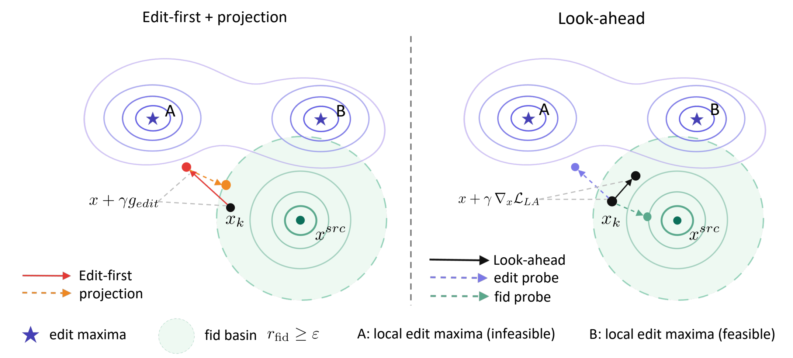

# Constrained Look-ahead Guidance for Interference-Aware Flow Editing [NeurIPS 2026]

[NeurIPS 2026] *Constrained Look-ahead Guidance for Interference-Aware Flow Editing* Official implementation.

<p align="center">
  
</p>

## News

- **[2026-09]** Our paper has been accepted to NeurIPS 2026.

## Abstract

Diffusion and flow models enable powerful generative modeling, but controlled
editing remains challenging due to the need to balance source fidelity and
edit compliance along the generative trajectory. We propose a principled,
inversion-free framework for flow-based image editing from a trajectory centric
perspective. Rather than relying on inversion or heuristic guidance, we
introduce a one-step look-ahead mechanism that evaluates the effect of
candidate updates on both edit and fidelity rewards estimated via denoising,
and adjusts the current update based on this evaluation. At each step, our
method applies reward-driven corrections guided by the look-ahead evaluation
under an explicit fidelity constraint, resulting in stable and coherent
trajectory evolution. This look-ahead design mitigates gradient interference
between edit and fidelity objectives by anticipating their interaction in
future states, leading to improved trade-offs. Experiments demonstrate that
the proposed approach achieves stronger semantic edits while better preserving
source content compared to existing inversion-based and inversion-free
methods.

## Usage

- [Environment Setup](docs/environment_setup.md): Python environment,
  dependencies, and pretrained model weights.
- [Inference](docs/inference.md): edit an image and adjust the
  hyperparameters.

## Acknowledgements

CLAG is built upon the following outstanding open-source works: [FLUX.1-dev](https://github.com/black-forest-labs/flux), [Diffusers](https://github.com/huggingface/diffusers), [CLIP](https://github.com/openai/CLIP), [PIE-Bench](https://github.com/cure-lab/PnPInversion), [DDIM Inversion](https://github.com/ermongroup/ddim), [TABA](https://github.com/luk-st/taba), [RF-Inversion](https://github.com/LituRout/RF-Inversion), [RF-Solver-Edit](https://github.com/wangjiangshan0725/RF-Solver-Edit), [FlowEdit](https://github.com/fallenshock/FlowEdit), [FlowChef](https://github.com/FlowChef/flowchef), [FlowAlign](https://github.com/FlowAlign/FlowAlign), and [ITOC](https://github.com/jinhojsk515/ITOC).

## Citation

If our work supports or enhances your research, please cite our paper.
Thank you!

```bibtex
@inproceedings{zhang2026clag,
  title     = {Constrained Look-ahead Guidance for Interference-Aware Flow Editing},
  author    = {Zhang, Doudou and Chen, Qi},
  booktitle = {Advances in Neural Information Processing Systems},
  year      = {2026}
}
```
